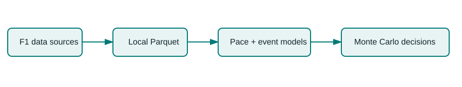

# RaceCraft

**A counterfactual Formula 1 race-strategy simulator.** It evaluates *pit now*, *extend*, and compound-change options from a driver-lap decision point, returning a distribution of simulated finish positions—not a falsely certain single answer.



## What works today

- A deterministic, tested race-state engine with tyre degradation, pit loss, traffic penalties, and safety-car scenarios.
- An all-car **digital-twin baseline**: multi-car race state, explicit opponent pit policies, sampled VSC/safety-car events, and replayable trajectories.
- Monte Carlo comparison of candidate pit windows on laptop CPU.
- Cached OpenF1 ingestion for 2023+ lap, stint, pit, race-control, and session data.
- FastF1 adapter (optional dependency) for richer 2018+ session timing and tyre data.
- Streamlit dashboard with included synthetic sample race data so the UI starts with no download.

## Quick start

```bash
cd racecraft
python -m venv .venv && source .venv/bin/activate
pip install -e '.[dev]'
streamlit run app/streamlit_app.py
pytest
```

For live OpenF1 data, install `requests` (included), then run:

```bash
python -m racecraft.ingestion.openf1 --year 2025 --out data/raw/openf1
```

Data are cached as Parquet locally and ignored by Git. OpenF1 historical data is available from 2023 onward; see [its API documentation](https://openf1.org/docs/). FastF1 data availability and caching are documented in the [FastF1 project](https://github.com/theOehrly/Fast-F1/tree/main/docs). Do not use the bundled code to scrape sources aggressively.

## Current scope and research integrity

The baseline models are deliberately transparent heuristics. The next milestone is fitting pace, opponent pit-window, and safety-car survival models on time-split historical data, then evaluating calibration and counterfactual *decision quality*. A real alternate strategy is unobserved, so RaceCraft never labels its recommendation as historical ground truth.

## Project layout

`src/racecraft` holds data contracts, ingestion, the simulator, and charts; `app/` is the UI; `tests/` protects the race-state logic; and `docs/` records methodology and data attribution.

## Attribution

OpenF1 is unofficial Formula 1 data. Jolpica and FastF1 have their own terms and rate limits. Keep source attribution in any public deployment and cache downloaded data. This repository ships only generated sample data.
